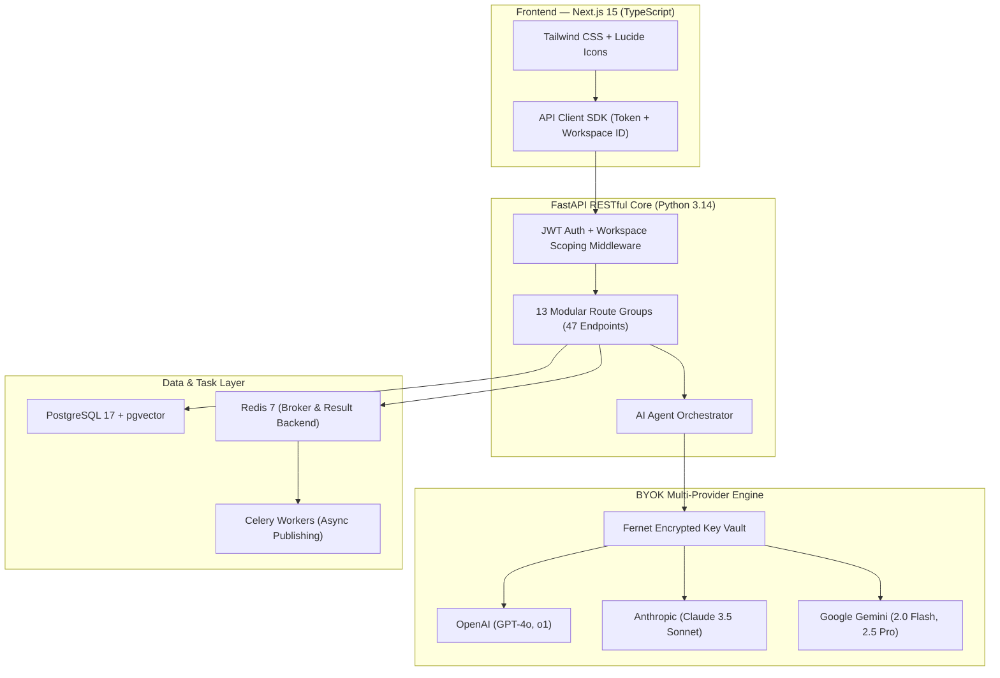

# AI GrowthDesk — Autonomous AI Marketing Workforce

**AI GrowthDesk** is a production-oriented, multi-tenant SaaS platform that replaces repetitive agency and marketing team operations with a collaborative workforce of 10+ specialized AI agents.

Customers subscribe to the platform under a **Bring Your Own Key (BYOK)** model—connecting their own OpenAI, Google Gemini, or Anthropic Claude API keys. All keys are encrypted at rest using server-side Fernet encryption, and tenant workspaces are strictly isolated.

---

## 🌟 Key Capabilities

### 1. The Autonomous AI Marketing Workforce
- **AI Marketing Director (Orchestrator)**: Interprets high-level business objectives (e.g. *"Promote my new fitness coaching program and generate 100 qualified leads over the next 30 days"*), formulates multi-phase strategies, delegates tasks, and tracks milestones.
- **Market Research Specialist**: Analyzes industry trends, audience buying triggers, and competitor positioning.
- **Brand Strategist**: Enforces voice guidelines, messaging pillars, and ensures prohibited claims are never made.
- **Content Creator**: Produces high-converting copy across Instagram, LinkedIn, X, YouTube, and SEO blogs.
- **Creative Director**: Formulates visual design concepts, creative briefs, and production-ready image prompts.
- **Social Media Manager**: Manages multi-channel distribution calendars, optimal posting cadence, and channel strategy.
- **Community Manager**: Monitors conversations, detects sentiment & buyer intent, and drafts brand-aligned responses.
- **Lead Generation & CRM Specialist**: Scores buying intent (0-100), captures leads, and designs follow-up workflows.
- **Paid Advertising Specialist**: Drafts high-ROAS ad copy variations (AIDA/PAS) and budget allocations.
- **SEO & Growth Strategist**: Identifies keyword clusters, content gaps, and optimizes for Google & GEO engines.
- **Growth Analyst**: Diagnoses multi-channel KPIs, conversion funnels, and delivers data-backed recommendations.

### 2. Brand Brain (Central Knowledge System)
- Central knowledge base containing company overview, products/services, target audience, brand voice, tone keywords, visual identity, and restricted claims.
- Reference document upload (PDFs, FAQs, transcripts) with vector similarity search (pgvector).

### 3. Human Approval Center (Human-in-the-Loop)
- Autonomous agents can plan and draft, but high-impact actions (publishing, ad spend, customer commitments) require explicit human sign-off.
- 1-click approvals and rejection with feedback notes.

### 4. Multi-Tenant SaaS Licensing & BYOK
- **Starter Tier ($49/mo)**: Single brand workspace, Marketing Director, Brand Brain, Content Studio, publishing calendar.
- **Professional Tier ($149/mo)**: 3 workspaces, all 10 specialist agents, CRM scoring, analytics loop.
- **Agency Tier ($399/mo)**: 25 client workspaces, strict client data isolation, white-label client approvals, Razorpay billing readiness.

---

## 🏗 Architecture & Tech Stack



---

## 🚀 Quickstart & Local Setup

### Prerequisites
- Node.js >= 18 (Node 22+ recommended)
- Python >= 3.12 (Python 3.14 supported with `uv`)
- PostgreSQL and Redis

### Option 1: Run with Development Script
From the repository root:
```bash
# 1. Start both servers in parallel
./scripts/run_dev.sh
```

### Option 2: Run Individually

**Backend:**
```bash
cd backend
uv sync
uv run uvicorn app.main:app --host 0.0.0.0 --port 8000 --reload
```
API Documentation will be available at [http://localhost:8000/docs](http://localhost:8000/docs).

**Frontend:**
```bash
cd frontend
npm install
npm run dev
```
Open [http://localhost:3000](http://localhost:3000) in your browser.

---

## 🧪 Testing

Run the automated backend test suite:
```bash
cd backend
uv run pytest
```

Build and type-check the Next.js frontend:
```bash
cd frontend
npm run build
```

---

## 🐳 Docker Deployment

To launch the full production stack with PostgreSQL (pgvector) and Redis:
```bash
cd docker
docker compose up -d --build
```

# Growth_Desk
